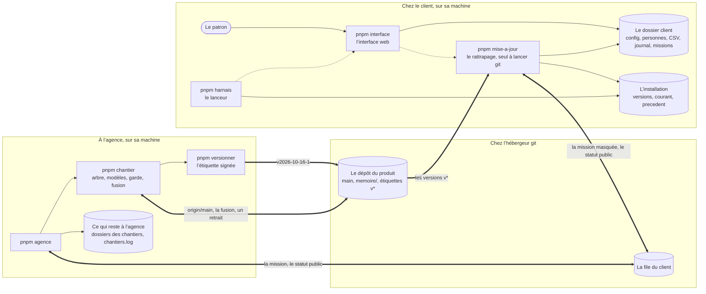
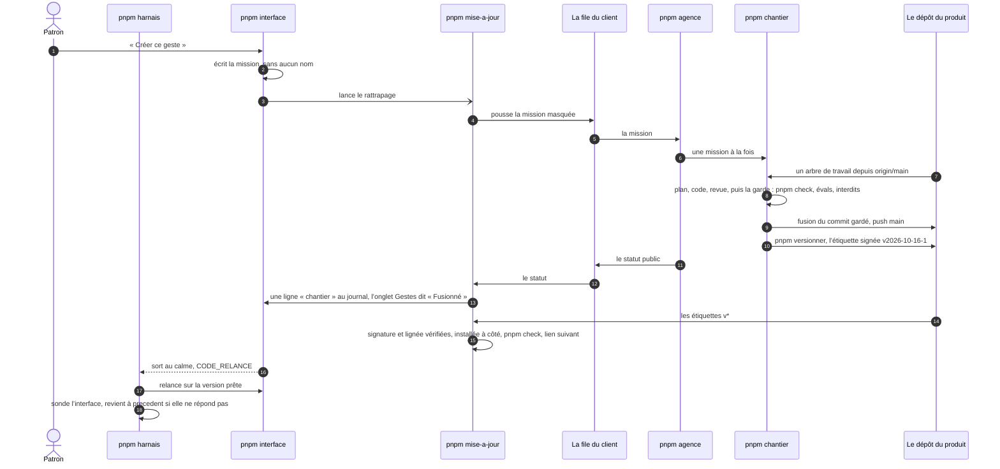
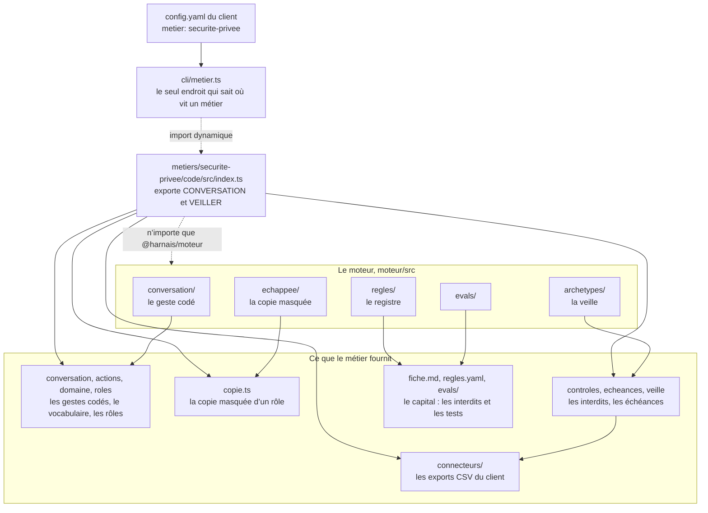
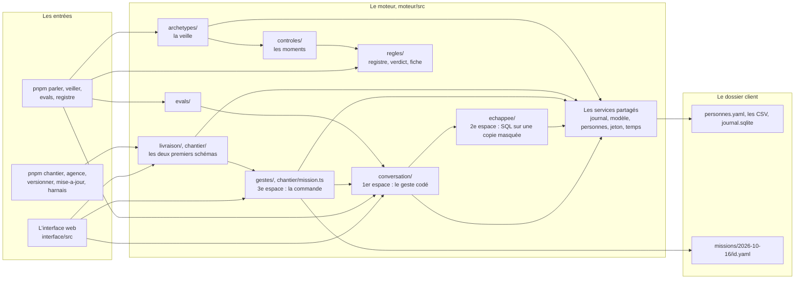

# agency-harness

Le capital de l'agence : un harnais agentique **par métier**, réutilisable d'un
client à l'autre.

Point de départ (2026-09-29) : une chaîne de production obéit à des règles.
Le réglementé se code, le tacite se recueille chez le client, le jugement
reste humain. Un harnais ne décrit pas le processus : il en décrit les
**bornes**, c'est-à-dire ce que l'agent sait, ce qu'il peut faire, ce qu'il ne
doit jamais faire, comment on reconnaît un travail juste, et quand il rend la
main.

## Les trois couches

| Couche | Contenu | Où | Réutilisable |
|---|---|---|---|
| **Moteur** | le registre des règles et le calendrier juridique, les contrôles par moment (pre-tool, post-tool, pre-response, stop) qui échouent fermés, l'approbation par clé d'accord, le journal, la veille, la conversation et ses trois espaces (un geste, l'échappée, la commande), le chantier qui code un geste commandé, la livraison signée et tirée, le compteur de coût | `moteur/` | tous métiers |
| **Méthode** | règles communes à tous les outils, le temps (validité à une date, calcul des délais), les archétypes (veiller, planifier, rapprocher, rédiger, chercher) et leurs questions | `methode/` | tous métiers ; c'est la spécification du moteur |
| **Métier** | chaîne, interdits, tests types, connecteurs, escalades, vocabulaire, préférences récurrentes, données à réunir, briques à proposer | `metiers/<métier>/fiche.md` | tous les clients d'un métier |
| **Client** | données, exceptions, savoir tacite, seuils ; ses missions commandées (`missions/<date>/<intention>.yaml`, un geste que le patron a demandé) | `clients/<client>/` — **jamais versionné** | ce client seul |

Le capital, ce sont les **interdits et les tests**, pas les prompts : un prompt
se réécrit à chaque changement de modèle, un test reste vrai des années.

## La carte

Quatre schémas, relevés sur les imports réels du code (2026-10-16) : qui
tourne où ; la vie d'une mission, de bout en bout ; ce que le moteur demande
à un métier ; le moteur vu de ses entrées. Une flèche pleine : un appel, une
lecture ou une écriture sur la même machine. Une flèche épaisse : git, d'une
machine à l'autre. Une flèche pointillée : un processus lancé, ou un import.
Les services que tout le monde appelle (journal, modèle, personnes, jeton,
temps) sont un seul nœud ; les fichiers de chaque module sont listés dans
« Structure ».

### Qui tourne où



### La vie d'une mission



### Ce que le moteur demande à un métier



### Le moteur, vu des entrées



## Structure

Un dossier, une ligne. Les mots sont dans `GLOSSAIRE.md`, les décisions dans
`REFLEXIONS.md`, l'état dans `HANDOFF.md`.

```
.
├── README.md              ce fichier : la carte, la structure, comment faire tourner
├── GLOSSAIRE.md           l'abécédaire : cent entrées, dont la table des commandes, la seule
├── HANDOFF.md             l'état à la dernière passation, deux pages : à lire en premier
├── REFLEXIONS.md          le fil des décisions, les pistes, ce qui reste à trancher
├── GRILLE.md              la grille d'une fiche métier : neuf rubriques, le métier contre le client
├── PLAN-GENERAL.md        le grand plan (décisions G1 à G11, phases) ; PLAN-LIVRAISON.md : la livraison (L1 à L12)
├── archives/              les plans exécutés et le journal des « Fait » : lecture historique seulement
├── agence.yaml            la config de l'agence, sans secret : modèles et prix du chantier, bornes, clients et files, chemins autorisés, client fictif des évals par métier
├── methode/               ce qui vaut dans deux métiers : socle.md (règles communes, temps, faits communs), archetypes.md (les cinq sortes de travail), architecture-pour-modeles.md (la carte que lisent les modèles d'un chantier), chantier.md (où un chantier écrit, ce qu'est un geste), les audits datés
├── memoire/               la mémoire des chantiers, écrite par le code, tirée par tous les clients : INDEX.md, chantiers/, CONVENTIONS.md, MESURES.md (à la main) ; un test relit qu'aucun nom n'y entre
├── moteur/src/            le code commun, @harnais/moteur ; il n'importe aucun métier
│   ├── regles/            le registre d'un métier : schéma, chargement, cohérence, tables de la fiche, verdicts plafonnés par le statut de la règle
│   ├── controles/         l'exécution des contrôles, fermée en cas d'erreur
│   ├── temps/             jours fériés, délais et reports, « 45 jours fin de mois », obligations périodiques, validité d'un titre à une date
│   ├── archetypes/        la veille (échéances, fenêtres, passe, rapport et ses sections métier), les écarts consommé / vendu, les candidats, la veille d'un client
│   ├── config.ts          la config d'un client, validée au démarrage
│   ├── journal/           le journal SQLite d'un client, en ajout seul
│   ├── approbation/       la clé d'accord : pas d'écriture sans la validation de ce contenu exact au journal
│   ├── personnes/         le registre d'accès (personnes.yaml) et l'identité vérifiée, avant toute ouverture du dossier
│   ├── modele/            l'accès au modèle derrière une interface à nous : l'API d'Anthropic, l'abonnement par le binaire claude, le simulé des tests, le compteur de coût
│   ├── conversation/      un tour : la porte, la traduction (une consigne, un geste de la liste), la désignation en code, les rôles et le domaine déclarés par le métier, les noms qui ne partent jamais, l'état
│   ├── echappee/          le deuxième espace : la copie SQLite masquée, le garde-fou SQL, la boucle bornée, le contrôle des nombres et des noms, les pseudonymes
│   ├── gestes/            les demandes sans geste et la commande du patron (la mission écrite par le code)
│   ├── chantier/          la mission, l'arbre de travail, la garde, le chantier, la fusion et le retrait, la mémoire, le binaire claude
│   ├── livraison/         la version signée, la file d'un client, l'agence, la mise à jour, le lanceur, le verrou
│   ├── agence/            agence.yaml et son préflight
│   ├── evals/             les contrôles binaires des évals, sans juge LLM ; la traduction rejouée sur des copies fraîches
│   └── cli/               une commande par fichier : registre, veiller, parler, evals, chantier, agence, versionner, mise-a-jour, rapport-html, metier (le métier d'un dossier client)
├── interface/             l'interface web, @harnais/interface : src/app.ts (Hono, chaque route passe la porte), src/serveur.ts (127.0.0.1 seulement), src/harnais.ts (le lanceur), public/ (HTML, CSS, JavaScript sans framework, la charte de presentation/)
├── metiers/<métier>/      la couche d'un secteur : fiche.md (fait foi ; ses tables 1, 2, 4 sont générées), regles.yaml et scenarios/ (le registre), code/ (le paquet du métier), evals/ (consignes.yaml, echappees.yaml), les instantanés de recherche datés, trois vues pour le terrain (prospection, entretien, observation)
│   ├── securite-privee/   codé : modèle, notions, contrôles, échéances, connecteur CSV, le remplacement validé par le patron, ses gestes
│   ├── agence-web/        codé : le second métier, qui prouve que le moteur est agnostique : vingt exports, neuf contrôles, deux veilles, huit gestes, ses évals
│   └── transport-logistique/, bureaux-etudes/, avocats-affaires/   décrits, pas codés
├── exemples/              deux clients fictifs, à copier avant tout essai : client-fictif (la sécurité : 13 agents, 19 vacations, des erreurs posées exprès), agence-web-fictive (vingt CSV, graine fixe) ; livraison.yaml commenté
├── evals/                 resultats/ (les tableaux datés d'une passe), traces/ (non versionnées), erreurs-*.md (les analyses)
├── presentation/          la page « Schéma du harnais » (smarttailor.fr/schema-harnais : copiée telle quelle dans ../smart-tailor/public/schema-harnais/, la ligne des polices remplacée par celles du site) et glossaire.mjs, qui génère smarttailor.fr/glossaire depuis GLOSSAIRE.md
├── clients/               les notes d'entretien, ignorées par git : ce que dit un client ne part nulle part
└── .claude/skills/entretien-metier/   le skill qui prépare l'entretien et transcrit les règles à valider, chaque citation vérifiée
```

## Faire tourner

Les commandes sont dans `GLOSSAIRE.md`, « Les commandes » : une table, la
seule, qu'un test de `pnpm check` compare aux scripts de `package.json`.
Node 22.12 ou plus, pnpm 10.32.1 (épinglé). Ce qui suit est ce que la table
ne dit pas.

### Au laboratoire

Toujours sur une copie d'un client fictif. Le modèle et son accès viennent
de la config du client (`conversation.modele`) : sans `acces`, l'API
d'Anthropic et `ANTHROPIC_API_KEY` ; `{ binaire: claude }`, l'abonnement par
le binaire (clé absente, coût estimé) ; `--modele simule`, aucun appel. Les
clients fictifs désignent Sonnet 5.5 par l'abonnement. Les évals écrivent
leurs traces dans `evals/traces/<horodatage>-<métier>-<quoi>/` et leur
tableau dans `evals/resultats/` ; chaque cas a sa colonne « fuite », les noms
du client partis au modèle, comptée en code, seuil 0 ; deux passes dans la
même minute écrivent au même endroit. La chaîne entière (`agence`,
`chantier`, `versionner`) se rejoue dans un laboratoire : un dossier
temporaire, un dépôt nu, une clé jetable, une copie du client fictif
(recette sous le lot 4 de `PLAN-LIVRAISON.md`). Jamais dans ce dépôt : ces
commandes poussent sur `origin`.

### À l'agence

`pnpm agence` est une boucle sous verrou. À chaque tour, la file git de
chaque client est tirée dans `.claude/missions/<slug>/` ; la mission à
prendre est celle du client qui a eu le moins de chantiers aujourd'hui, puis
la plus ancienne, au plus `chantiers_max_par_jour` par jour ; une mission
d'un autre métier que son client est écartée. Préflight (binaire connecté,
clé de signature, `origin` joignable : sinon rien n'est écrit), statut « en
cours », puis le chantier : la décision en code (retirée, geste déjà codé :
aucun appel) ; un arbre de travail de ce dépôt parti d'`origin/main` (ni
l'arbre de qui lance ni son `main` ne bougent) ; Fable planifie, Opus code
dans la bande du métier ; la garde ; `pnpm check` rejoué ; Fable relit, une
reprise au plus ; l'honnêteté (`pnpm evals traduire`, trois cas par geste) ;
le rejeu (`pnpm evals rejeu`) ; la mémoire ; et, les neuf conditions vertes,
la fusion `--no-ff` du commit gardé dans un arbre détaché, l'étiquette
`chantier/<métier>/<id>`, la version signée, le push atomique sur `main` du
distant. Le dossier et le statut complets restent à l'agence
(`.claude/missions/_chantiers/<slug>/<date>/`) ; la file reçoit le statut
public. `pnpm chantier retirer <métier>/<id> --motif` défait une fusion (`git revert
-m 1`), pose une version, écrit la mémoire et le statut « retiré ». `pnpm
versionner` pose une version sans chantier : quand le moteur a changé, pas
juste après un chantier. La signature : `AGENCE_CLE_SIGNATURE` est le chemin
de la clé privée SSH de l'agence, hors du dépôt (`ssh-keygen -t ed25519`,
OpenSSH 8.2 au moins) ; son chemin et l'agent SSH ne passent ni au modèle ni
à `pnpm check`, mais le code que le modèle écrit tourne sous le même
utilisateur et pourrait lire le fichier : ouvert (`HANDOFF.md`, « avant un
client réel »).

### Chez un client livré

Le dossier porte `livraison.yaml` et `signataires` ; les clés SSH des deux
dépôts (une clé de déploiement par client et par sens) sont dans
`~/.ssh/config`, jamais dans le dépôt ni dans la config. Une seule chose
s'installe à la main, le lanceur, lancé depuis l'installation : launchd
(macOS) avec `ProgramArguments = /bin/sh -c "cd <installation>/courant &&
pnpm harnais --client <dossier>"` et `KeepAlive = { SuccessfulExit = false }`
(l'arrêt voulu n'est pas relancé) ; systemd avec
`WorkingDirectory=<installation>/courant`, `ExecStart=pnpm harnais --client
<dossier>`, `Restart=on-failure`. Ni l'un ni l'autre ne lisent le PATH d'un
shell : celui où sont node et pnpm se donne, sinon pnpm est introuvable.
L'interface lance le rattrapage (`pnpm mise-a-jour`) dans un processus à
part : à son démarrage, toutes les `intervalle_minutes`, à l'ouverture de
l'onglet « Gestes », après une commande ; il pousse les missions marquées,
tire les statuts, prépare la version suivante à côté (signature vérifiée
contre `signataires`, lignée, `pnpm check` rejoué dans son arbre). Une
version refusée pour de bon, ou revenue en arrière, n'est jamais reprise, ni
aucune plus ancienne. Quand une version est prête, l'interface sort au
moment calme (code 75) ; le lanceur bascule, sonde (`POST /api/roles`,
trente essais d'une seconde), revient en arrière sans réponse ou sur trois
plantages dans les dix minutes ; trois plantages hors de cette fenêtre :
arrêt, un humain regarde. `pnpm mise-a-jour retirer` revient à la
précédente à la main. Ce que le client voit : l'onglet « Gestes » dit
« Version v…, mise à jour le … » et, pour chaque commande, en attente de
l'agence, chantier en cours, fusionné (v…), mise à jour en préparation,
disponible ; le journal dit « mise à jour : faite, refusée, retour arrière ».

## Le déroulé d'un rendez-vous

0. **L'appel** : `prospection.md` du métier ; son seul but est le premier
   rendez-vous.
1. **La veille** : le skill adapte au client `entretien.md` et
   `observation.md` du métier.
2. **Sur place** : l'entretien du dirigeant, puis la journée d'observation ;
   tout s'enregistre avec l'accord de chaque présent ; les briques se
   proposent en dernier.
3. **Après** : la transcription donne `clients/<slug>/entretien-….md` (la
   grille remplie) et `clients/<slug>/regles-a-valider-….md` (les règles, dans
   les mots du client, chacune avec sa citation), vérifiés par le script.
4. **Le client corrige** les règles ; elles deviennent l'annexe du devis. Le
   prix, les conditions et les mentions du devis sont posés par le fondateur,
   jamais par le skill.
5. **Le métier s'enrichit** : ce qui vaut chez un concurrent remonte dans la
   fiche, sans nom ni chiffre du client, après accord. Ce qui se retrouve
   dans deux métiers remonte dans `methode/`.

## Règles

- **Rien d'inventé.** Chaque fait d'une fiche porte sa source et son statut
  (`GRILLE.md` § Statuts). Une hypothèse se marque comme telle, elle ne se
  déguise pas en fait.
- **Aucune donnée client dans `metiers/`.** Un fait monte du client au métier
  seulement s'il vaut pour tout le secteur, et il monte sans nom, sans
  chiffre du client, sans document.
- **Aucun montant.** Même règle que le site : le prix se fixe à l'atelier.
